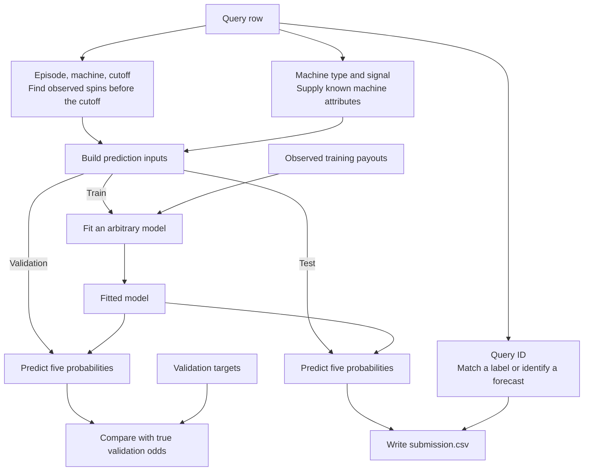

# House Edge | TAMU Datathon

Predict the next spin of a simulated slot machine. For each test query, output five probabilities for the possible gross payouts on a one-chip wager: **0×, 1×, 2×, 5×, and 20×**. A 0× payout loses the wager, and a 1× payout returns it. The five probabilities describe one spin and must add up to 1.

The organizer's main-round kit lives in `main-participants-60-40/`. Git ignores that folder, so each checkout needs a local copy of the extracted kit for the links and commands below.

## How a query becomes a forecast



An **episode** groups eight machines on one timeline. Each full `machine_id` belongs to one episode. A suffix such as `m000` repeats across episodes, where it refers to a different machine. Other episodes supply examples to learn from. The current episode supplies the spin history for the current prediction.

### Query fields and history lookup

| Field | What it tells you |
|---|---|
| `query_id` | The key for joining labels or targets and identifying a row in the output CSV. |
| `episode_id` | Which group of eight machines to look in. |
| `machine_id` | Which exact machine to predict. Index its history by `(episode_id, machine_id)`. |
| `machine_type` | `steady`, `balanced`, or `jackpot`. In the training logs, steady machines paid out more often and jackpot machines hit 20× more often. Balanced machines fell in between. |
| `signal` | An observed value of `-1`, `0`, or `1`. The kit leaves its simulator meaning unspecified. A model can learn whether those categories help. |
| `cutoff` | The tick to predict, from 192 through 256. Use spins at ticks strictly below this value, including spins from other machines in the same episode. |

Each row of `history.csv` contains `episode_id,machine_id,tick,payout`. The payout is one observed result, such as 2×, and ticks start at zero. A full history contains every tick from zero through `cutoff - 1`. A short history contains the latest 40 consecutive ticks plus 24 sampled older ticks. Keep the actual tick numbers so a missing tick stays distinct from a recorded 0× payout.

## What each split gives you

All three splits contain `queries.csv`, `history.csv`, and `sample_submission.csv`. Episode IDs are disjoint across splits. If you make your own holdout, keep all eight machines from an episode together.

| Split | Episodes | Queries | What you do with it |
|---|---:|---:|---|
| [Train](main-participants-60-40/public/train/) | 96 | 768 | Fit a model on query fields and past spins. Join `labels.csv` by `query_id` to get the single realized payout at each cutoff. You can also make extra examples from history by choosing an observed spin as the label and using only earlier spins as inputs. |
| [Validation](main-participants-60-40/public/validation/) | 96 | 768 | Give the fitted model the validation queries and past spins. Compare its predictions with the simulator's true odds in `targets.csv`. Use `reference.csv` and `conditions.csv` to calculate competition points and compare model settings. The split also includes sampled outcomes in `labels.csv`. |
| [Test](main-participants-60-40/public/test/) | 192 | 1,536 | Give the chosen model the test queries and past spins. Save one forecast per query. The organizers hold the test outcomes, true odds, condition labels, and reference forecasts. |

### Real rows from the kit

- **Train.** `main-train-e00000-m000-next` asks about a steady machine with signal `1` at tick `238`. Its last three input spins are `(235, 1)`, `(236, 0)`, and `(237, 1)`. The label is the **2× payout at tick 238**, which the training procedure uses as the answer.
- **Validation.** `main-validation-e00000-m000-next` asks about a balanced machine with signal `0` at tick `221`. Its last three input spins are `(218, 0)`, `(219, 2)`, and `(220, 0)`. The model estimates five probabilities. The scorer compares those estimates with the true odds, approximately `[0.2601, 0.3698, 0.2574, 0.0965, 0.0161]`.
- **Test.** `main-test-e00000-m000-next` asks about a balanced machine with signal `-1` at tick `221`. It has 64 observed spins, including all ticks from `181` through `220`. The starter produced the following output for this query, rounded here for display.

```csv
query_id,p_0,p_1,p_2,p_5,p_20
main-test-e00000-m000-next,0.722283,0.125207,0.099084,0.026701,0.026725
```

## Conditions and scoring

A machine's type describes its general payout behavior. A condition describes the episode's scenario. The training and validation splits provide the condition in `conditions.csv`.

| Condition | What to look for |
|---|---|
| `stable` | Relatively consistent payout patterns. |
| `short_history` | The 64-observation pattern of 40 consecutive recent spins and 24 sampled older spins. |
| `drift` | Payout patterns can shift gradually over time. |
| `shared_change` | Payout patterns can change together across machines in an episode. |

The scorer measures squared error against the simulator's **five true probabilities**. It averages error within each episode, averages episodes within each condition, and divides each condition's error by the frozen starter's error for that condition. The four ratios count equally. Round points are the round maximum divided by `1 + average ratio`. The main round is worth 60 points. Adaptation is worth 40 and uses a separate kit with fresh episodes and changed patterns. Main-round code and data can be reused in adaptation.

## Main-round model selection

**Current recommendation: switching Bayesian lag pairs (`switch_96`) with the self-only logistic positive payout head.** It scored **53.383 / 60 on tuning** and **52.665 / 60 on the separate audit**, beating the previous boosted/logistic leader's **49.213 audit points**. This is the strongest evidence for generalization among the evaluated models; hidden-test performance remains unknown. [Bayesian experiment](runs/bayesian-lag-pairs/replay/report.json), [frozen audit](runs/bayesian-lag-pairs/audit-switch-96/report.json).

The model learns which pair of earlier win/loss outcomes matters for each machine and allows the pair's effect to change over time. Its frozen settings are a uniform prior over all 28 lag pairs, signed amplitudes `{-2,-1,+1,+2}`, reset hazard `1/96`, no evidence discounting, and a 12-tick win offset with strength 8. The self-only logistic model supplies the conditional probabilities of 1×, 2×, 5× and 20× given a positive payout. The complete audited model bundle is [frozen_models.joblib](runs/bayesian-lag-pairs/audit-switch-96/frozen_models.joblib); the accompanying [freeze manifest](runs/bayesian-lag-pairs/audit-switch-96/freeze.json) records its settings and hashes.

Tuning and audit each contain 48 episodes and 384 queries, with 12 episodes per condition. **The audit has already been used** for the frozen Bayesian-versus-boosted comparison. Further choices informed by that result need fresh episodes for an independent confirmation. A dash below means no saved audit comparison for that configuration.

| Forecast | Tuning points / 60 | Audit points / 60 | Assessment |
|---|---:|---:|---|
| Switching Bayesian pairs + logistic head, uniform pair prior | 53.383 | **52.665** | Recommended frozen candidate |
| Switching Bayesian pairs + logistic head, learned pair prior `rho=0.8` | **53.800** | — | Promising challenger; did not pass its promotion threshold |
| Bayesian/boosted blend, weights fitted outside each tuning fold | 53.393 | — | Only 0.010 above standalone Bayesian; no compelling reason to add a fitted blend |
| Boosted rate-3072 win probability + logistic head | 50.274 | 49.213 | Previous leader; useful fallback |
| Boosted correction, rate 3072 | 49.744 | — | Strong improvement over adaptive control |
| Individual peer lags, rate 3072 | 44.117 | — | No clear gain over matched adaptive control |
| Adaptive lag, rate 1536 / 3072 | 44.104 / 44.098 | — | Rates effectively tied; 3072 selected on grouped training |
| Regime filter, rate 3072 | 43.950 | — | No demonstrated improvement over adaptive control |
| Signed lag motifs | 42.026 | — | Weak under drift and shared changes |
| Learned transition retrieval | 41.233 | — | Behind Bayesian and boosted candidates |
| Boosted correction, rate 48 | 37.775 | — | Superseded by the rate-3072 version |
| Original adaptive lag, rate 48 | 33.225 | — | Original control |
| Self-only causal CNN | 31.597 | — | No competitive sequence-model gain in this experiment |
| Logistic families, fixed retrieval and frequency/fixed-lag controls | 31.133–31.444 | — | Useful controls; logistic payout head remains valuable in the stronger models |

The Bayesian audit gain is **3.453 points**, with paired `ΔR = -0.07993` and a saved 95% episode-bootstrap interval of `[-0.12438, -0.04198]`. It improves short history, drift and shared change; boosted wins the stable audit condition (`R=0.0768` versus Bayesian's `0.0936`). The overall Bayesian advantage remains when any single condition is omitted. These intervals describe fixed forecasts on observed episodes, not a guaranteed test score or uncertainty adjusted for every model tried.

The learned pair prior improves tuning by **0.417 points**, mostly on short histories. Its `ΔR=-0.00871` misses the experiment's required `-0.01`, and [the report records `advances=false`](runs/bayesian-lag-pair-tuning/replay/report.json). Nested training evaluation shows a much smaller gain: cutoff win Brier `0.082812 → 0.082452`, with two folds improving, one worsening and one unchanged. Keep the audited uniform-prior model as the default; the higher tuning score alone does not establish a better test model.

The adversarial review used three GPT-6 Astra reviewers at xhigh reasoning, independently rescored 152 saved tuning CSVs (72 distinct normalized prediction arrays), checked frozen artifacts, and ran 19 targeted tests. All tests passed, and a fresh Bayesian replay reproduced the four saved candidate CSVs with zero maximum probability difference. No causal leakage invalidating the recommended model was found. Public test histories retain the same lag availability and inferred common-pair prevalence; that supports main-round transfer without revealing test accuracy. Remaining risks include short-history uncertainty, repeated use of tuning, fixed lag-pair identity within each Bayesian hypothesis, and changed temporal relationships in adaptation. [Full review and verification](main-participants-60-40/adversarial_review/REVIEW.md). The [earlier experiment summary](EXPERIMENT_RESULTS.md) documents the superseded boosted leader and predates the Bayesian audit.

To replay the Bayesian tuning experiment from the repository root, keep the saved component CSVs and use a fresh output directory:

```sh
python -B run_bayesian_lag_pairs.py \
  --out runs/bayesian-lag-pairs/fresh \
  --compare-to runs/bayesian-lag-pairs/replay
```

This writes tuning forecasts. Before submission, the frozen Bayesian model and logistic head still need a forecast-only entry point for the 1,536 test queries, an offline reproduction check, and the required code ZIP. The starter commands below export the pooled starter; they do not export this recommended model.

## Project layout

| Path | Contents |
|---|---|
| [slot_forecasting/](slot_forecasting/) | Custom forecasting models and the kit interfaces used by project runners. |
| [models/](models/) | Saved model checkpoints. |
| [runs/](runs/) | Tuning predictions, the frozen audit, model checkpoints, and replay evidence. |
| [model_briefs/](model_briefs/) | Model implementation and verification briefs. |
| [ML_TRAINING_PLAN.md](ML_TRAINING_PLAN.md) | Initial data audit and training plan. |
| [main-participants-60-40/](main-participants-60-40/) | Original organizer kit, including the released data and starter. |

From the repository root, install the optional project dependencies and run the initial tuning comparison.

```sh
python -m pip install -r requirements-models.txt
python -B run_model_comparison.py --out runs/model-comparison-fresh
```

The main experiment runners default to the kit's `public/` directory. Use a fresh output folder for each run. They continue to use the same 48 tuning episodes; the separate audit was already consumed by the frozen comparison above. The Bayesian comparison runners enforce the main round, so adaptation requires a new comparison and fresh validation evidence.

## Participant kit index

| Path inside `main-participants-60-40/` | What it contains |
|---|---|
| [README.md](main-participants-60-40/README.md), [DATA.md](main-participants-60-40/DATA.md), [RULES.md](main-participants-60-40/RULES.md) | Official walkthrough, data dictionary, and competition rules. |
| [public/metadata.json](main-participants-60-40/public/metadata.json), [SHA256.json](main-participants-60-40/SHA256.json) | Round, season ID, dataset sizes, and checksums for the distributed kit files. |
| [run_starter.py](main-participants-60-40/run_starter.py), [starter.ipynb](main-participants-60-40/starter.ipynb) | Command-line and notebook walkthroughs for baseline forecasts. |
| [run_experiments.py](main-participants-60-40/run_experiments.py), [EXPERIMENTS.md](main-participants-60-40/EXPERIMENTS.md) | Example experiments and how to compare models on validation episodes. |
| [slot_forecasting/](main-participants-60-40/slot_forecasting/) | Python package. `io.py` reads the CSVs, `schema.py` defines and checks rows, `baseline.py` and `transition.py` implement example models, and `scoring.py`, `contest.py`, and `rounds.py` handle scoring. |
| [check_submission.py](main-participants-60-40/check_submission.py), [build_entry.py](main-participants-60-40/build_entry.py), [SUBMISSION_README.md](main-participants-60-40/SUBMISSION_README.md) | CSV checker, entry packager, and reproducibility README template. |

## Run the starter and prepare a submission

From the repository root, with Python 3.11 or newer:

```sh
cd main-participants-60-40
python3 run_starter.py --out outputs
python3 check_submission.py outputs/validation_predictions.csv --split validation
python3 check_submission.py outputs/submission.csv
python3 build_entry.py --starter outputs --out entry.zip
```

The starter compares six baselines on validation and exports `pooled` by default. For a custom model, follow the packaging instructions in the [participant guide](main-participants-60-40/README.md#package-a-custom-model).

Submit the **test CSV** and the **code ZIP** separately through the round's form. Include every test `query_id` once, exactly the six CSV columns shown above, and five finite values between 0 and 1 that sum to 1 within `1e-6`. The ZIP must contain the code and settings needed to reproduce the CSV offline, with `README.md` and `reproduce.json` at its root. The local test check verifies the CSV format and query coverage.
