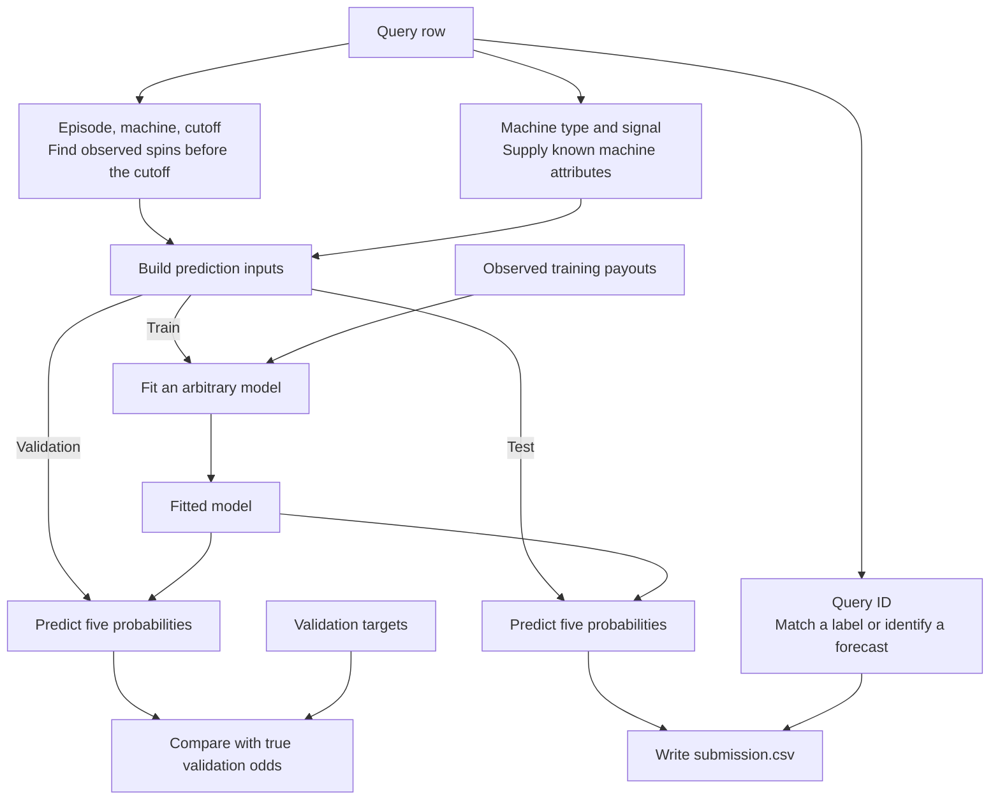

# House Edge | TAMU Datathon

Predict the next spin of a simulated slot machine. For each test query, output five probabilities for the possible gross payouts on a one-chip wager: **0×, 1×, 2×, 5×, and 20×**. A 0× payout loses the wager, and a 1× payout returns it. The five probabilities describe one spin and must add up to 1.

The organizer's main-round kit lives in `main-participants-60-40/`. Git ignores that folder, so each checkout needs a local copy of the extracted kit for the links and commands below.

## How a query becomes a forecast



An **episode** groups eight machines on one timeline. Each full `machine_id` belongs to one episode. A suffix such as `m000` repeats across episodes, where it refers to a different machine. Other episodes supply examples to learn from. The current episode supplies the spin history for the current prediction.

### Query fields and history lookup

| Field | What it tells you |
|---|---|
| `query_id` | The key for joining labels or targets and identifying a row in the output CSV. |
| `episode_id` | Which group of eight machines to look in. |
| `machine_id` | Which exact machine to predict. Index its history by `(episode_id, machine_id)`. |
| `machine_type` | `steady`, `balanced`, or `jackpot`. In the training logs, steady machines paid out more often and jackpot machines hit 20× more often. Balanced machines fell in between. |
| `signal` | An observed value of `-1`, `0`, or `1`. The kit leaves its simulator meaning unspecified. A model can learn whether those categories help. |
| `cutoff` | The tick to predict, from 192 through 256. Use spins at ticks strictly below this value, including spins from other machines in the same episode. |

Each row of `history.csv` contains `episode_id,machine_id,tick,payout`. The payout is one observed result, such as 2×, and ticks start at zero. A full history contains every tick from zero through `cutoff - 1`. A short history contains the latest 40 consecutive ticks plus 24 sampled older ticks. Keep the actual tick numbers so a missing tick stays distinct from a recorded 0× payout.

## What each split gives you

All three splits contain `queries.csv`, `history.csv`, and `sample_submission.csv`. Episode IDs are disjoint across splits. If you make your own holdout, keep all eight machines from an episode together.

| Split | Episodes | Queries | What you do with it |
|---|---:|---:|---|
| [Train](main-participants-60-40/public/train/) | 96 | 768 | Fit a model on query fields and past spins. Join `labels.csv` by `query_id` to get the single realized payout at each cutoff. You can also make extra examples from history by choosing an observed spin as the label and using only earlier spins as inputs. |
| [Validation](main-participants-60-40/public/validation/) | 96 | 768 | Give the fitted model the validation queries and past spins. Compare its predictions with the simulator's true odds in `targets.csv`. Use `reference.csv` and `conditions.csv` to calculate competition points and compare model settings. The split also includes sampled outcomes in `labels.csv`. |
| [Test](main-participants-60-40/public/test/) | 192 | 1,536 | Give the chosen model the test queries and past spins. Save one forecast per query. The organizers hold the test outcomes, true odds, condition labels, and reference forecasts. |

### Real rows from the kit

- **Train.** `main-train-e00000-m000-next` asks about a steady machine with signal `1` at tick `238`. Its last three input spins are `(235, 1)`, `(236, 0)`, and `(237, 1)`. The label is the **2× payout at tick 238**, which the training procedure uses as the answer.
- **Validation.** `main-validation-e00000-m000-next` asks about a balanced machine with signal `0` at tick `221`. Its last three input spins are `(218, 0)`, `(219, 2)`, and `(220, 0)`. The model estimates five probabilities. The scorer compares those estimates with the true odds, approximately `[0.2601, 0.3698, 0.2574, 0.0965, 0.0161]`.
- **Test.** `main-test-e00000-m000-next` asks about a balanced machine with signal `-1` at tick `221`. It has 64 observed spins, including all ticks from `181` through `220`. The starter produced the following output for this query, rounded here for display.

```csv
query_id,p_0,p_1,p_2,p_5,p_20
main-test-e00000-m000-next,0.722283,0.125207,0.099084,0.026701,0.026725
```

## Conditions and scoring

A machine's type describes its general payout behavior. A condition describes the episode's scenario. The training and validation splits provide the condition in `conditions.csv`.

| Condition | What to look for |
|---|---|
| `stable` | Relatively consistent payout patterns. |
| `short_history` | The 64-observation pattern of 40 consecutive recent spins and 24 sampled older spins. |
| `drift` | Payout patterns can shift gradually over time. |
| `shared_change` | Payout patterns can change together across machines in an episode. |

The scorer measures squared error against the simulator's **five true probabilities**. It averages error within each episode, averages episodes within each condition, and divides each condition's error by the frozen starter's error for that condition. The four ratios count equally. Round points are the round maximum divided by `1 + average ratio`. The main round is worth 60 points. Adaptation is worth 40 and uses a separate kit with fresh episodes and changed patterns. Main-round code and data can be reused in adaptation.

## Current recommendation across branches

**Use Amir's M3 explicit flip-time lag-pair model as the main-round candidate.** The expanded adversarial review covered all three remote branches and found that the earlier checkout review had missed a stronger model family. On the same **96 validation episodes and 768 queries**, M3 scores **55.268 / 60**, compared with **53.037** for the previous switching Bayesian/logistic recommendation. M3 improves every condition and 79 of 96 episodes. A fresh fit reproduced its saved predictions within **1.34e-14**. [Full branch review](main-participants-60-40/adversarial_review/branches/REVIEW.md), [M3 source and design](https://github.com/Amir-Suh/TAMU-Datathon-2027/blob/c339b469de33bbc2b2c68ea739eeec835139d42b/models/m3_lag_pair_flip/MODEL.md).

The reviewed heads are `amir_workspace` at `c339b46`, `fredy/bakeoff-gbdt-seq` at `5ba591c`, and `main` at `c7da3c5` (README only). All six Amir models and all five Fredy arm implementations, including declared variants and blend/packaging paths, were reviewed. The previously reviewed custom suite and 11 identical organizer-kit modules were excluded from duplicate code review. [Coverage and source hashes](main-participants-60-40/adversarial_review/branches/coverage.json).

| Model | Full-validation points / 60 | Assessment |
|---|---:|---|
| **Amir M3: explicit flip time** | **55.268** | Recommended; independently rescored and replayed |
| Amir M4: shared flip time | 55.283 | Close alternative; only 0.015 points above M3 |
| Amir M6: ensemble | **55.297** | Highest saved score; only 0.028 above M3 and inherits M5's feature defect |
| Amir M5: boosted corrector | 54.988 | Worse than M3; batch-dependent feature and incomplete base cross-fitting |
| Fredy GRU128, no peer message | 53.098–53.578 | Three logged seeds; validation-selected epochs; fitted artifacts absent from branch |
| Previous checkout: switching Bayesian + logistic head | 53.037 | Strong fallback; combined saved tuning and audit predictions |
| Amir M2: lag-pair rules | 52.598 | Strong static model, weaker under changing regimes |
| Previous checkout: boosted + logistic head | 49.767 | Earlier benchmark |
| Fredy GBDT, best logged variant | 36.395 | Substantially behind pair and sequence models |
| Fredy GLM, best logged variant | 31.093 | No clear advantage over frequency control |
| Amir M1: hierarchical frequency | 31.092 | Weak baseline |
| Pooled_recent control | 30.826 | Shared kit control |
| Fredy regime model, best logged variant | 30.779 | No demonstrated gain over control |

Amir and previous-checkout scores above were independently recomputed from saved CSVs. Fredy's learned-arm scores are **reported pilot results**: its prediction arrays and model checkpoints are git-ignored and were not published with the branch. Its peer-message and larger GRU variants have no committed result establishing superiority. The prior checkout's full model table remains in the [earlier review](main-participants-60-40/adversarial_review/REVIEW.md).

M3 models a persistent lag pair whose win/loss direction may reverse once, integrating uncertainty about when the reversal happened. It can reuse observations from both sides of that reversal. Its advantage over the previous Bayesian model is **2.231 points**, with paired `ΔR=-0.04567` and a descriptive 95% episode-bootstrap interval of `[-0.06102, -0.03134]`. M6's much smaller advantage over M3 has an interval crossing zero. M4's tiny favorable interval does exclude zero for these fixed forecasts, but its practical gain is small and does not account for model selection.

The most important review findings are:

- **M5/M6 depend on unrelated prediction rows.** Their recent-history feature counts the batch's last 64 columns instead of each machine's 64 pre-cutoff ticks. It is wrong on 749 of 768 validation rows. M3/M4 direct forecasts are unaffected; fixing the correction requires retraining it.
- **Training selection is not fully held out.** Amir's pseudo-query scores reuse full-training empirical priors, and M5 cross-fits only the classifier after fitting its base on all training episodes. This weakens the case for small corrections and ensemble gains. No direct external-validation-target leakage invalidating M3 was found.
- **Fredy's GRU is competitive but not ready through its generic exporter.** The exporter rejects a training-only PyTorch import even though inference uses NumPy. The default pipeline also still selects the 36.395-point GBDT, not the GRU.
- **There is no fresh audit left in these comparisons.** Amir evaluated all 96 validation episodes, and Fredy selected epochs while watching validation. Reusing the earlier 48/48 partition is descriptive, not a new independent audit. Confidence intervals hold forecasts fixed and do not guarantee a test score.

Main-test generalization looks strongest for M3/M4, but their learned pair prevalence and single-flip assumptions need renewed evaluation in adaptation. Keep the previous uniform-prior switching Bayesian model as a fallback. The complete [review](main-participants-60-40/adversarial_review/branches/REVIEW.md) includes limitations, source locations, targeted checks and common-data comparisons.

M3's source and test-output runner live on `amir_workspace`, with an inspected snapshot under `main-participants-60-40/adversarial_review/branches/amir/`. In that branch's checkout, its existing command is:

```sh
python -m models.run --models m3 --out results/m3-fresh
```

Use a fresh output directory and the branch's dependencies. The runner refits on train, writes validation and test forecasts, and checks test IDs/probabilities. All 12 saved test CSVs across Amir's two run batches passed independent format/coverage checks during review. An organizer-compatible code ZIP and offline reproduction check are still required before upload. The starter commands below generate the pooled starter, not M3.

## Project layout

| Path | Contents |
|---|---|
| [slot_forecasting/](slot_forecasting/) | Custom forecasting models and the kit interfaces used by project runners. |
| [models/](models/) | Saved model checkpoints. |
| [runs/](runs/) | Tuning predictions, the frozen audit, model checkpoints, and replay evidence. |
| [model_briefs/](model_briefs/) | Model implementation and verification briefs. |
| [ML_TRAINING_PLAN.md](ML_TRAINING_PLAN.md) | Initial data audit and training plan. |
| [main-participants-60-40/](main-participants-60-40/) | Original organizer kit, including the released data and starter. |

From the repository root, install the optional project dependencies and run the initial tuning comparison.

```sh
python -m pip install -r requirements-models.txt
python -B run_model_comparison.py --out runs/model-comparison-fresh
```

The original checkout's experiment runners default to the kit's `public/` directory and continue to use the same 48 tuning episodes. Their earlier audit was already consumed. Amir and Fredy use full-validation development results, as documented above. Use fresh output folders and fresh validation evidence when evaluating adaptation.

## Participant kit index

| Path inside `main-participants-60-40/` | What it contains |
|---|---|
| [README.md](main-participants-60-40/README.md), [DATA.md](main-participants-60-40/DATA.md), [RULES.md](main-participants-60-40/RULES.md) | Official walkthrough, data dictionary, and competition rules. |
| [public/metadata.json](main-participants-60-40/public/metadata.json), [SHA256.json](main-participants-60-40/SHA256.json) | Round, season ID, dataset sizes, and checksums for the distributed kit files. |
| [run_starter.py](main-participants-60-40/run_starter.py), [starter.ipynb](main-participants-60-40/starter.ipynb) | Command-line and notebook walkthroughs for baseline forecasts. |
| [run_experiments.py](main-participants-60-40/run_experiments.py), [EXPERIMENTS.md](main-participants-60-40/EXPERIMENTS.md) | Example experiments and how to compare models on validation episodes. |
| [slot_forecasting/](main-participants-60-40/slot_forecasting/) | Python package. `io.py` reads the CSVs, `schema.py` defines and checks rows, `baseline.py` and `transition.py` implement example models, and `scoring.py`, `contest.py`, and `rounds.py` handle scoring. |
| [check_submission.py](main-participants-60-40/check_submission.py), [build_entry.py](main-participants-60-40/build_entry.py), [SUBMISSION_README.md](main-participants-60-40/SUBMISSION_README.md) | CSV checker, entry packager, and reproducibility README template. |

## Run the starter and prepare a submission

From the repository root, with Python 3.11 or newer:

```sh
cd main-participants-60-40
python3 run_starter.py --out outputs
python3 check_submission.py outputs/validation_predictions.csv --split validation
python3 check_submission.py outputs/submission.csv
python3 build_entry.py --starter outputs --out entry.zip
```

The starter compares six baselines on validation and exports `pooled` by default. For a custom model, follow the packaging instructions in the [participant guide](main-participants-60-40/README.md#package-a-custom-model).

Submit the **test CSV** and the **code ZIP** separately through the round's form. Include every test `query_id` once, exactly the six CSV columns shown above, and five finite values between 0 and 1 that sum to 1 within `1e-6`. The ZIP must contain the code and settings needed to reproduce the CSV offline, with `README.md` and `reproduce.json` at its root. The local test check verifies the CSV format and query coverage.
