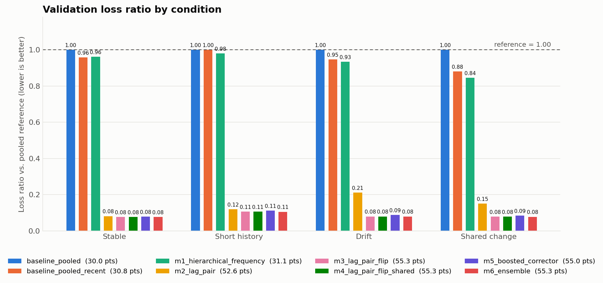

# Results

Each run of `python -m models.run` writes one dated folder here. Runs are never overwritten.

| Run | Best model | Validation points /60 | Notes |
|---|---|---|---|
| [2026-11-07_m1_to_m6](2026-11-07_m1_to_m6/summary.md) | `m6_ensemble` / `m3_lag_pair_flip` | **55.30 / 55.27** | Adds the flip-aware model, shared flip, boosted corrector and ensemble |
| [2026-11-07_m1_m2](2026-11-07_m1_m2/summary.md) | `m2_lag_pair` | 52.60 | First comparison of the kit baselines, m1 and m2 |

## Latest comparison (2026-11-07_m1_to_m6)

Loss ratio is the model's error divided by the frozen pooled reference's error for that condition. Lower is better, and 1.00 means the same as the reference. The episode-bootstrap noise is about ±0.5 points.

| Model | Points /60 | Stable | Short history | Drift | Shared change |
|---|---|---|---|---|---|
| `m6_ensemble` | **55.30** | 0.077 | 0.106 | 0.080 | 0.078 |
| `m4_lag_pair_flip_shared` | 55.28 | 0.077 | 0.106 | 0.080 | 0.078 |
| `m3_lag_pair_flip` | 55.27 | 0.077 | 0.107 | 0.080 | 0.078 |
| `m5_boosted_corrector` | 54.99 | 0.079 | 0.112 | 0.089 | 0.085 |
| `m2_lag_pair` | 52.60 | 0.082 | 0.119 | 0.211 | 0.151 |
| `m1_hierarchical_frequency` | 31.09 | 0.962 | 0.979 | 0.933 | 0.845 |
| kit `pooled_recent` | 30.83 | 0.958 | 1.001 | 0.946 | 0.880 |
| kit `pooled` (reference) | 30.00 | 1.000 | 1.000 | 1.000 | 1.000 |

**What each step bought:**

| Step | Model | Change | Δ points |
|---|---|---|---|
| Better size model | — | No usable signal found, see [FINDINGS.md](../models/FINDINGS.md) §3 | 0 |
| Change-point model | m3 | Explicit flip time; drift ratio 0.21 → 0.08, shared change 0.15 → 0.08 | **+2.67** over m2 |
| Shared episode flip | m4 | One flip time per episode | +0.01 (noise) |
| Boosted corrector | m5 | GBM on m4's outputs | −0.29 |
| Ensemble | m6 | 83% m3 + 17% m5 | +0.03 (noise) |

Each run folder holds:

- `summary.md`: the tables.
- `scores.json`: the same results in machine-readable form.
- One subfolder per model containing `validation_predictions.csv`, `submission.csv` (test, format-checked) and `params.json`.
