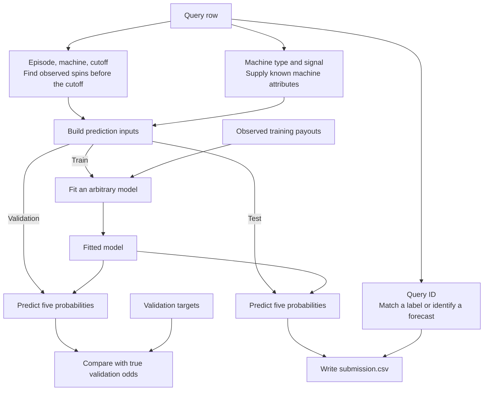

# House Edge | TAMU Datathon

Predict the next spin of a simulated slot machine. For each test query, output five probabilities for the possible gross payouts on a one-chip wager: **0×, 1×, 2×, 5×, and 20×**. A 0× payout loses the wager, and a 1× payout returns it. The five probabilities describe one spin and must add up to 1.

The organizer's main-round kit lives in `main-participants-60-40/`. Git ignores that folder, so each checkout needs a local copy of the extracted kit for the links and commands below.

## How a query becomes a forecast



An **episode** groups eight machines on one timeline. Each full `machine_id` belongs to one episode. A suffix such as `m000` repeats across episodes, where it refers to a different machine. Other episodes supply examples to learn from. The current episode supplies the spin history for the current prediction.

### Query fields and history lookup

| Field | What it tells you |
|---|---|
| `query_id` | The key for joining labels or targets and identifying a row in the output CSV. |
| `episode_id` | Which group of eight machines to look in. |
| `machine_id` | Which exact machine to predict. Index its history by `(episode_id, machine_id)`. |
| `machine_type` | `steady`, `balanced`, or `jackpot`. In the training logs, steady machines paid out more often and jackpot machines hit 20× more often. Balanced machines fell in between. |
| `signal` | An observed value of `-1`, `0`, or `1`. The kit leaves its simulator meaning unspecified. A model can learn whether those categories help. |
| `cutoff` | The tick to predict, from 192 through 256. Use spins at ticks strictly below this value, including spins from other machines in the same episode. |

Each row of `history.csv` contains `episode_id,machine_id,tick,payout`. The payout is one observed result, such as 2×, and ticks start at zero. A full history contains every tick from zero through `cutoff - 1`. A short history contains the latest 40 consecutive ticks plus 24 sampled older ticks. Keep the actual tick numbers so a missing tick stays distinct from a recorded 0× payout.

## What each split gives you

All three splits contain `queries.csv`, `history.csv`, and `sample_submission.csv`. Episode IDs are disjoint across splits. If you make your own holdout, keep all eight machines from an episode together.

| Split | Episodes | Queries | What you do with it |
|---|---:|---:|---|
| [Train](main-participants-60-40/public/train/) | 96 | 768 | Fit a model on query fields and past spins. Join `labels.csv` by `query_id` to get the single realized payout at each cutoff. You can also make extra examples from history by choosing an observed spin as the label and using only earlier spins as inputs. |
| [Validation](main-participants-60-40/public/validation/) | 96 | 768 | Give the fitted model the validation queries and past spins. Compare its predictions with the simulator's true odds in `targets.csv`. Use `reference.csv` and `conditions.csv` to calculate competition points and compare model settings. The split also includes sampled outcomes in `labels.csv`. |
| [Test](main-participants-60-40/public/test/) | 192 | 1,536 | Give the chosen model the test queries and past spins. Save one forecast per query. The organizers hold the test outcomes, true odds, condition labels, and reference forecasts. |

### Real rows from the kit

- **Train.** `main-train-e00000-m000-next` asks about a steady machine with signal `1` at tick `238`. Its last three input spins are `(235, 1)`, `(236, 0)`, and `(237, 1)`. The label is the **2× payout at tick 238**, which the training procedure uses as the answer.
- **Validation.** `main-validation-e00000-m000-next` asks about a balanced machine with signal `0` at tick `221`. Its last three input spins are `(218, 0)`, `(219, 2)`, and `(220, 0)`. The model estimates five probabilities. The scorer compares those estimates with the true odds, approximately `[0.2601, 0.3698, 0.2574, 0.0965, 0.0161]`.
- **Test.** `main-test-e00000-m000-next` asks about a balanced machine with signal `-1` at tick `221`. It has 64 observed spins, including all ticks from `181` through `220`. The starter produced the following output for this query, rounded here for display.

```csv
query_id,p_0,p_1,p_2,p_5,p_20
main-test-e00000-m000-next,0.722283,0.125207,0.099084,0.026701,0.026725
```

## Conditions and scoring

A machine's type describes its general payout behavior. A condition describes the episode's scenario. The training and validation splits provide the condition in `conditions.csv`.

| Condition | What to look for |
|---|---|
| `stable` | Relatively consistent payout patterns. |
| `short_history` | The 64-observation pattern of 40 consecutive recent spins and 24 sampled older spins. |
| `drift` | Payout patterns can shift gradually over time. |
| `shared_change` | Payout patterns can change together across machines in an episode. |

The scorer measures squared error against the simulator's **five true probabilities**. It averages error within each episode, averages episodes within each condition, and divides each condition's error by the frozen starter's error for that condition. The four ratios count equally. Round points are the round maximum divided by `1 + average ratio`. The main round is worth 60 points. Adaptation is worth 40 and uses a separate kit with fresh episodes and changed patterns. Main-round code and data can be reused in adaptation.

## Current recommendation across branches

**Use M3's explicit flip-time lag-pair model as the main-round candidate.** M5 and M6 have now been repaired and retrained with complete episode cross-validation. Repaired M6 is only **0.014 points** above M3 on public validation, while M3 performs better in the separate held-episode training assessment. Repaired M5 is worse in both comparisons. [Full repair results](results/repaired-m5-m6/README.md).

| Current model | Full-validation points / 60 | Assessment |
|---|---:|---|
| **M3: explicit flip time** | **55.268370** | Recommended; fresh fit reproduces archived predictions |
| M4: shared flip time | 55.282990 | Close diagnostic alternative |
| M5: repaired boosted classifier | 54.841763 | Worse than M3 |
| M6: repaired ensemble | 55.282043 | Tiny gain over M3, with uncertainty crossing zero |

The comparison uses all **96 validation episodes and 768 queries**. M6's paired loss-ratio change versus M3 is `−0.000268`, with a descriptive 95% episode-bootstrap interval of `[−0.000796, +0.000292]`. M5's is `+0.008445`, with interval `[+0.003679, +0.013916]`; lower is better. Validation was already used in model development, so this is not a fresh audit or proof of test superiority.

The two outer training folds refit every member, M5's tree-count selection, and M6's weights while excluding complete held episodes. M3's binary log-loss is **0.303219**, versus **0.313175** for M5 and **0.303447** for M6. At the original train cutoffs, the losses are **0.266357**, **0.277766**, and **0.267517** respectively. Each outer fit used 48 episodes; these noisy-outcome binary losses differ from the contest's five-class true-probability metric. [Outer-fold report](results/repaired-m5-m6/train_outer_summary.md).

### What was repaired

- Recent-history counts now use each query's own 64 pre-cutoff ticks. M3's direct predictions remain unchanged.
- M5 now constructs its classifier training features from episode-heldout M4 fits, with nested episode folds for tree-count selection.
- M6 fits blend weights from episode-heldout predictions of every member, including M5's full fitting and selection procedure. Additional outer folds assess the complete blend.
- Fit-cache fingerprints include histories and labels. Selection and weight-fitting losses are clearly distinguished from heldout assessment.

All **10 regression tests pass**. Saved checkpoints replay within **2.23e-16**; actual-model row-order, padding, and isolated-episode checks pass within **2.61e-14**. M3's archived validation/test forecasts are reproduced within **4.08e-14**. Final M5 chose **100 trees**; M6 uses approximately **67.04% M3, 21.67% M4, and 11.29% M5**. [Implementation and reproduction](M5_M6_REPAIR.md), [independent source review](results/repaired-m5-m6/REPAIR_REVIEW.md).

### Earlier all-branch review

The review covered `amir_workspace` at `c339b46`, `fredy/bakeoff-gbdt-seq` at `5ba591c`, and `main` at `c7da3c5` (README only): all six Amir models and all five Fredy arm implementations, including variants and export paths. Previously reviewed custom models and identical organizer-kit modules were excluded from duplicate review. [Review and limitations](main-participants-60-40/adversarial_review/branches/REVIEW.md), [coverage and source hashes](main-participants-60-40/adversarial_review/branches/coverage.json).

M3's **55.268** exceeds the previous checkout's switching Bayesian/logistic model at **53.037**, improving all four conditions and 79 of 96 episodes. Fredy's best logged GRU runs scored **53.098–53.578**; their checkpoints were absent from the branch and epoch selection used validation. The full earlier model table remains in the linked review. The archived M5 **54.987969** and M6 **55.296582** scores describe the defective pre-repair implementation; the current table above supersedes them. Historical source snapshots remain unchanged.

M3/M4 still depend on learned pair prevalence and single-flip assumptions. Re-evaluate those assumptions for adaptation, and retain the previous uniform-prior switching Bayesian model as a fallback.

### Reproduce and use the repaired models

The source is now installed in [models/](models/). From the repository root:

```sh
python -m pip install -r requirements-repaired-models.txt
python -B run_repaired_comparison.py prepare --out results/repaired-fresh --outer-folds 2 \
  --previous main-participants-60-40/adversarial_review/branches/amir/results/2026-11-07_m1_to_m6
python -B run_repaired_comparison.py score --out results/repaired-fresh
python -B verify_repaired_inference.py --out results/repaired-fresh
```

Use a fresh output folder. Training choices and forecasts are frozen before validation scoring. The completed run has [M3](results/repaired-m5-m6/m3/submission.csv), [M5](results/repaired-m5-m6/m5/submission.csv), and [M6](results/repaired-m5-m6/m6/submission.csv) test CSVs, plus `models.joblib`. All four exported models pass the official checker for **1,536 test queries**. No test score is available, and no upload was performed. An organizer-compatible code ZIP and offline reproduction check are still needed before upload. The starter commands below generate the pooled starter.

## Project layout

| Path | Contents |
|---|---|
| [slot_forecasting/](slot_forecasting/) | Custom forecasting models and the kit interfaces used by project runners. |
| [models/](models/) | M1–M6 source, repaired crossfit utilities, and existing saved checkpoints. |
| [results/repaired-m5-m6/](results/repaired-m5-m6/) | Repaired fits, comparison, frozen predictions, and verification. |
| [runs/](runs/) | Tuning predictions, the frozen audit, model checkpoints, and replay evidence. |
| [model_briefs/](model_briefs/) | Model implementation and verification briefs. |
| [ML_TRAINING_PLAN.md](ML_TRAINING_PLAN.md) | Initial data audit and training plan. |
| [main-participants-60-40/](main-participants-60-40/) | Original organizer kit, including the released data and starter. |

From the repository root, install the optional project dependencies and run the initial tuning comparison.

```sh
python -m pip install -r requirements-models.txt
python -B run_model_comparison.py --out runs/model-comparison-fresh
```

The original checkout's experiment runners default to the kit's `public/` directory and continue to use the same 48 tuning episodes. Their earlier audit was already consumed. Amir and Fredy use full-validation development results, as documented above. Use fresh output folders and fresh validation evidence when evaluating adaptation.

## Participant kit index

| Path inside `main-participants-60-40/` | What it contains |
|---|---|
| [README.md](main-participants-60-40/README.md), [DATA.md](main-participants-60-40/DATA.md), [RULES.md](main-participants-60-40/RULES.md) | Official walkthrough, data dictionary, and competition rules. |
| [public/metadata.json](main-participants-60-40/public/metadata.json), [SHA256.json](main-participants-60-40/SHA256.json) | Round, season ID, dataset sizes, and checksums for the distributed kit files. |
| [run_starter.py](main-participants-60-40/run_starter.py), [starter.ipynb](main-participants-60-40/starter.ipynb) | Command-line and notebook walkthroughs for baseline forecasts. |
| [run_experiments.py](main-participants-60-40/run_experiments.py), [EXPERIMENTS.md](main-participants-60-40/EXPERIMENTS.md) | Example experiments and how to compare models on validation episodes. |
| [slot_forecasting/](main-participants-60-40/slot_forecasting/) | Python package. `io.py` reads the CSVs, `schema.py` defines and checks rows, `baseline.py` and `transition.py` implement example models, and `scoring.py`, `contest.py`, and `rounds.py` handle scoring. |
| [check_submission.py](main-participants-60-40/check_submission.py), [build_entry.py](main-participants-60-40/build_entry.py), [SUBMISSION_README.md](main-participants-60-40/SUBMISSION_README.md) | CSV checker, entry packager, and reproducibility README template. |

## Run the starter and prepare a submission

From the repository root, with Python 3.11 or newer:

```sh
cd main-participants-60-40
python3 run_starter.py --out outputs
python3 check_submission.py outputs/validation_predictions.csv --split validation
python3 check_submission.py outputs/submission.csv
python3 build_entry.py --starter outputs --out entry.zip
```

The starter compares six baselines on validation and exports `pooled` by default. For a custom model, follow the packaging instructions in the [participant guide](main-participants-60-40/README.md#package-a-custom-model).

Submit the **test CSV** and the **code ZIP** separately through the round's form. Include every test `query_id` once, exactly the six CSV columns shown above, and five finite values between 0 and 1 that sum to 1 within `1e-6`. The ZIP must contain the code and settings needed to reproduce the CSV offline, with `README.md` and `reproduce.json` at its root. The local test check verifies the CSV format and query coverage.
